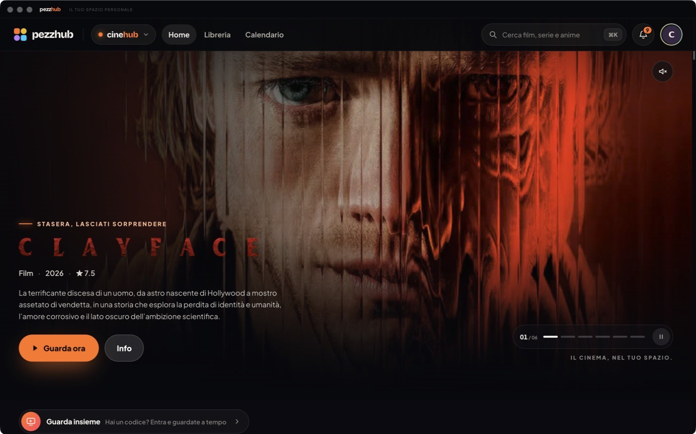
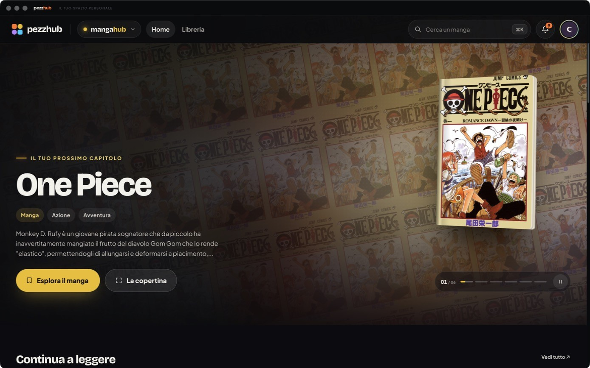
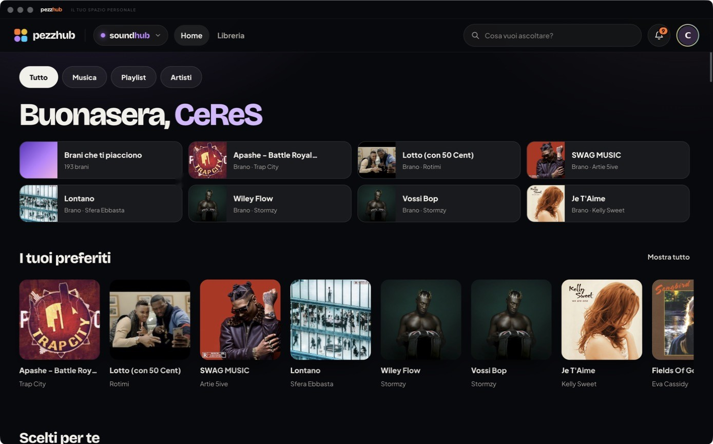

# pezzhub

**Movies, TV shows, anime, manga, music and live TV in one free app, with your progress in sync on every device.**

[Website](https://pezzhub.netlify.app/) · [Download](https://github.com/ceres077/pezzhub-releases/releases/latest) · [Community on Reddit](https://www.reddit.com/r/pezzhub) · [Report a problem](https://github.com/ceres077/pezzhub-releases/issues)

  
   
  <a href="https://github.com/ceres077/pezzhub-releases/raw/main/media/pezzhub-presentation.mp4"><b>▶ Watch the full presentation (50 s, with sound)</b></a>

## 📺 New: pezzhub on Samsung TV

pezzhub now runs on **Samsung smart TVs with Tizen (2020 and newer)**: movies and TV shows with the TV's own player,
manga, music and live TV, all with the remote and in sync with your other devices. Install it from your
computer with **pezzhub for Samsung TV**, a small program that finds your TV, prepares it and installs pezzhub, no
developer tools needed.

| Your computer | Download the installer |
|---|---|
| Windows 10 or 11 | **[pezzhub-tv-samsung-setup.exe](https://github.com/ceres077/pezzhub-releases/releases/download/tizen-channel/pezzhub-tv-samsung-setup.exe)** |
| Mac with Apple Silicon | **[pezzhub-tv-samsung-mac-arm64.zip](https://github.com/ceres077/pezzhub-releases/releases/download/tizen-channel/pezzhub-tv-samsung-mac-arm64.zip)** |
| Mac with an Intel processor | **[pezzhub-tv-samsung-mac-x64.zip](https://github.com/ceres077/pezzhub-releases/releases/download/tizen-channel/pezzhub-tv-samsung-mac-x64.zip)** |
| Linux (64-bit) | **[pezzhub-tv-samsung-linux.AppImage](https://github.com/ceres077/pezzhub-releases/releases/download/tizen-channel/pezzhub-tv-samsung-linux.AppImage)** |

  
   
  <a href="https://github.com/ceres077/pezzhub-releases/raw/main/media/pezzhub-samsung-tv.mp4"><b>▶ Watch the video: pezzhub on Samsung TV and how to install it</b></a>

How it works, in short (details in [Installing](#installing)): put the TV in Developer Mode once, open the installer,
choose your TV and click *Install pezzhub*. To update, run the installer again.

## What it does

pezzhub puts four "worlds" in one place, and everyone at home gets their own profile with their own library,
progress and taste. With an optional pezzhub account everything stays in sync between your devices in real time:
pause an episode on your PC and resume it on your TV at the same second.

- 🎬 **Movies, TV shows & anime** – trailers, TMDB ratings, "Continue watching", release calendar, watch diary and
  "Watch together" to watch a title in sync with a friend. Built-in MPV player with fullscreen and picture-in-picture.
- 📚 **Manga** – manga, manhwa and manhua with a built-in reader that remembers your chapter and page.
- 🎵 **Music** – songs, albums, artists and playlists, synced lyrics, reorderable queue, song radio and Spotify
  favorites import.
- 📺 **Live TV** – channels and a full TV guide with your own Xtream (IPTV) subscription.
- 📈 **AniList & Simkl tracking** – the anime and movies you finish and the manga chapters you read are marked on your
  AniList and Simkl lists automatically, and your lists come into pezzhub.
- 🔄 **Real-time sync** – profiles, library, progress, playlists and connected accounts follow you everywhere.
- 👥 **Profiles** – one for every person at home, up to six.

Works with **Stremio add-ons** and **Nuvio plugin repositories**. Free, no ads.
Available in English, Italian, French, Spanish and German.

## The four worlds

| | |
|---|---|
|  | **cinehub** · Movies, TV shows and anime. A featured showcase with trailers, detail pages with plot and ratings, "Continue watching", library, release calendar, diary and "Watch together". |
|  | **Detail pages** · Plot, TMDB ratings and trailer. Resume from the saved minute, add to your list or to tonight's plan, mark as watched. |
|  | **mangahub** · Manga, manhwa and manhua: catalog, personal library, reader, and resume from the chapter and page you reached. |
|  | **soundhub** · Songs, albums, artists and playlists. Favorites, a reorderable queue, synced lyrics, radio from the song you're playing, and Spotify favorites import. |
|  | **tvhub and library** · tvhub brings live channels and a TV guide with your own Xtream subscription. The library gathers your list, history, diary and downloads, per profile. |

## Supported devices

| Device | Requirements | File to download |
|---|---|---|
| Windows | 64-bit Windows 10 or 11 | `pezzhub-setup-X.Y.Z.exe` |
| Mac with Apple Silicon (M1, M2, M3, M4…) | macOS 11 or later | `pezzhub-mac-arm64-X.Y.Z.dmg` |
| Mac with an Intel processor | macOS 11 or later | `pezzhub-mac-x64-X.Y.Z.dmg` |
| Android phone and tablet | Android 8 or later, 64-bit | `pezzhub-android-X.Y.Z.apk` |
| Android TV (alpha) | Android TV 8 or later | `pezzhub-tv-X.Y.Z.apk` |
| Linux (CachyOS, Arch and Arch-based) | 64-bit (x86_64), `mpv` | [`pezzhub-linux.pacman`](https://github.com/ceres077/pezzhub-releases/releases/download/linux-channel/pezzhub-linux.pacman) or [`pezzhub-linux.AppImage`](https://github.com/ceres077/pezzhub-releases/releases/download/linux-channel/pezzhub-linux.AppImage) |
| Samsung TV (Tizen) | Samsung smart TV from 2020 or newer, Developer Mode, a computer on the same network | the installer [for Windows](https://github.com/ceres077/pezzhub-releases/releases/download/tizen-channel/pezzhub-tv-samsung-setup.exe), [Mac](https://github.com/ceres077/pezzhub-releases/releases/download/tizen-channel/pezzhub-tv-samsung-mac-arm64.zip) ([Intel](https://github.com/ceres077/pezzhub-releases/releases/download/tizen-channel/pezzhub-tv-samsung-mac-x64.zip)) or [Linux](https://github.com/ceres077/pezzhub-releases/releases/download/tizen-channel/pezzhub-tv-samsung-linux.AppImage) |

Every file is in the [latest release](https://github.com/ceres077/pezzhub-releases/releases/latest); the two Linux
links above always point to the latest Linux version. Each version ships for all devices with the same number.

On **Android TV** everything works with the remote: rows of titles, a side bar, voice search from the remote's
microphone and a first-run guide. The TV app is still in **alpha**, so expect some rough edges.

On **Samsung TV** pezzhub plays movies with the TV's own built-in player and everything works with the remote.

**Coming soon:** LG TV (webOS).

## One account, everything in sync

An account is optional: without one, pezzhub works locally. With an account, every change reaches your other
devices right away: profiles, library, watch history and progress, preferences, music (favorites, playlists,
recent plays and queue), manga and tvhub. Linked accounts (Stremio, Trakt, AniList, Simkl and extensions with a key)
are set up once and work everywhere. When two devices change the same thing, the latest change wins.
A deleted profile disappears from every device.

## Installing

- **Windows:** run the setup and follow the installer.
- **Mac:** open the dmg and drag pezzhub to Applications. pezzhub has no paid Apple certificate, so macOS asks
  for confirmation on first launch: open *System Settings › Privacy & Security* and click *Open Anyway*.
  You only need to do this once.
- **Android:** open the APK on your phone and, if Android asks, allow installs from that source.
- **Android TV:** copy the APK to the TV (for example with a USB stick) and open it with a file manager.
- **Linux:** install the package with `sudo pacman -U pezzhub-linux.pacman` (it brings in `mpv` if missing), or make the
  AppImage executable and run it (it needs `mpv` and `fuse2`).
- **Samsung TV:** you need a computer (Windows, Mac or Linux) on the same network as the TV.
  1. On the TV, once: open *Apps*, type **1 2 3 4 5** with the remote, switch *Developer mode* **On**, enter your
     computer's IP address as *Host PC IP* (the installer shows it) and restart the TV.
  2. Open **pezzhub for Samsung TV** on the computer, click *Search the network* (or type the TV's IP address) and
     choose your TV.
  3. Click *Install pezzhub*. The first time, sign in to your free Samsung account: it's needed for the certificate
     that lets the TV accept pezzhub, and the certificate stays on your computer. Google sign-in doesn't work there:
     use your Samsung account's email and password.
  4. pezzhub opens on the TV: sign in to your pezzhub account (also from your phone, with the QR code) and everything
     comes back. To update pezzhub on the TV, run the installer again.

  On a Mac the installer has no paid Apple certificate either: unzip it, then confirm it once in *System Settings ›
  Privacy & Security*. On Linux make the AppImage executable and run it.

Updates then arrive from the app, in *Settings › Updates*: pezzhub downloads the new version, checks its SHA-256
fingerprint and offers to install it. Profiles and settings are kept. The Mac `.zip` files and the `android-…`
entries on the releases page are used by automatic updates: you don't need to download them.

## Community and feedback

Join **[r/pezzhub](https://www.reddit.com/r/pezzhub)** for feedback, bug reports, feature ideas and help.
Join even if you only lurk.

pezzhub is a one-person project and help is very welcome: beta testers (especially for Android TV, Samsung TV and the
upcoming LG app), translators, designers and developers. Open an
[issue](https://github.com/ceres077/pezzhub-releases/issues) or write on r/pezzhub.

## Virus check

Every installer of the latest release is scanned on VirusTotal. Version 1.1.11: **0 detections** on every file.

| File | VirusTotal report |
|---|---|
| `pezzhub-setup-1.1.11.exe` (Windows) | [d14cfb20…](https://www.virustotal.com/gui/file/d14cfb205f1023b46463a1cadb0d789f1b0cac7b8c0978107e14cc8ef1c43552) |
| `pezzhub-mac-arm64-1.1.11.dmg` (Mac Apple Silicon) | [ae0c3476…](https://www.virustotal.com/gui/file/ae0c347646f75ccb06eb2f663221885c30f987a026b9dd8cdb088013f59afcb0) |
| `pezzhub-mac-x64-1.1.11.dmg` (Mac Intel) | [d497a6fc…](https://www.virustotal.com/gui/file/d497a6fcd4e94c96ff8d2243e6204a98eba7940d6a750b3a15b8479fbb5d3fa1) |
| `pezzhub-android-1.1.11.apk` (Android phone and tablet) | [08b05f87…](https://www.virustotal.com/gui/file/08b05f87112fc144594eb50308ef5fc330244d00dc3893fa6ab72f56d2b341ac) |
| `pezzhub-tv-1.1.11.apk` (Android TV) | [fc2547be…](https://www.virustotal.com/gui/file/fc2547beb3f4c12ea57a4e8041a8c7b54d8fb00fb1b21f92545dc7cc402bb7b2) |

The link is the SHA-256 of the file: compare it with the file you downloaded to be sure it's the same one.

## Content, security and privacy

pezzhub does not provide or host any content: it only uses the sources, extensions and subscriptions you set up
yourself, which you must have the right to access. This repository only holds installers, release notes and this
page: no personal data, credentials or media files. The source code lives in a separate repository. Only download
pezzhub from this repository's releases.

## Reporting a problem

Open an [issue](https://github.com/ceres077/pezzhub-releases/issues) with your pezzhub version, your device and
the steps to reproduce the problem. Don't attach passwords, tokens or links that contain credentials.
