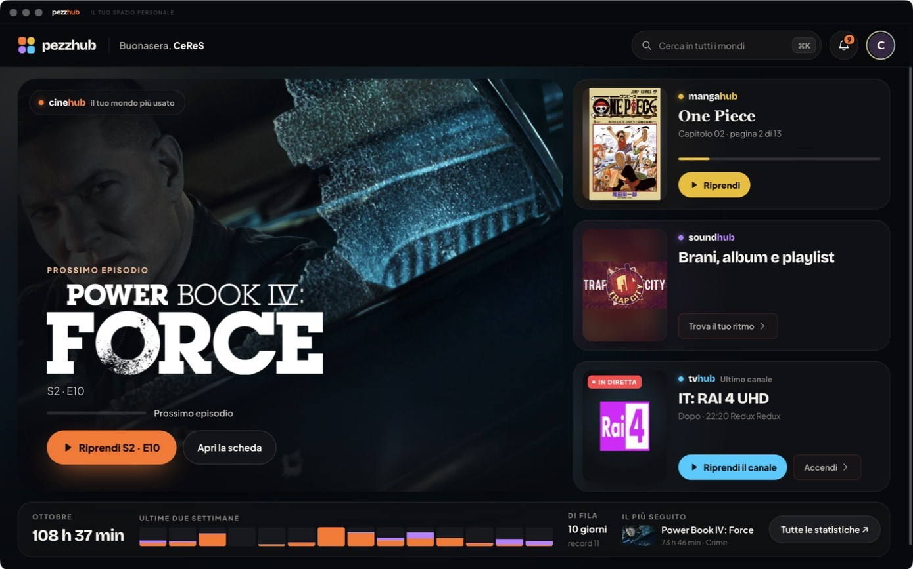
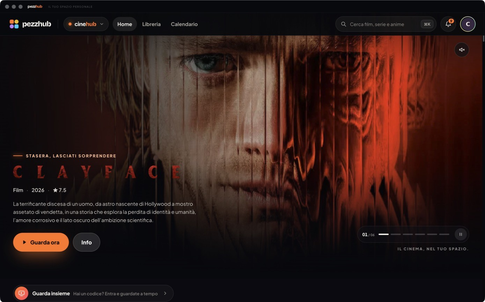
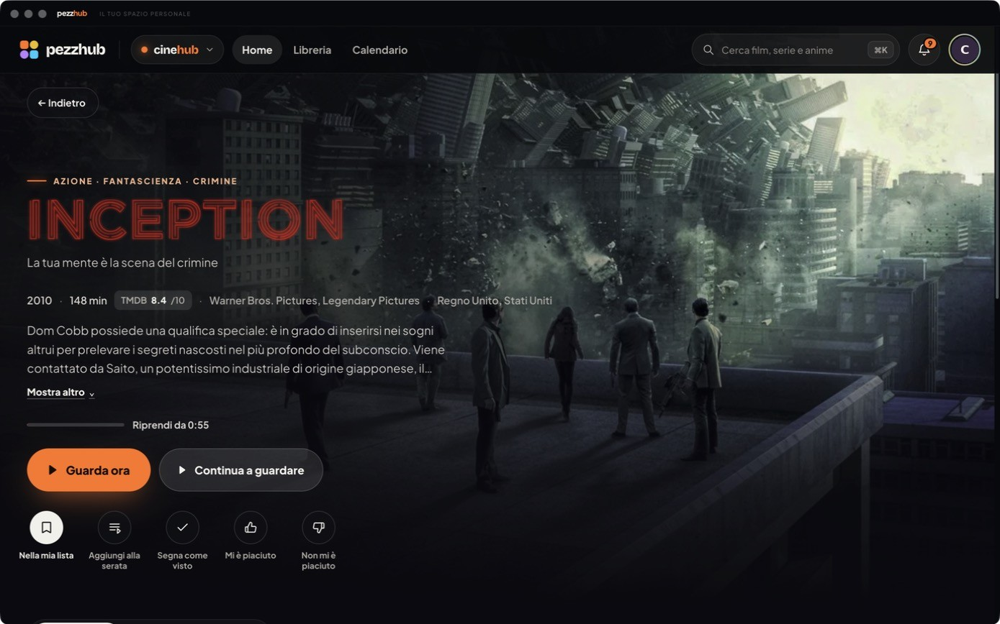
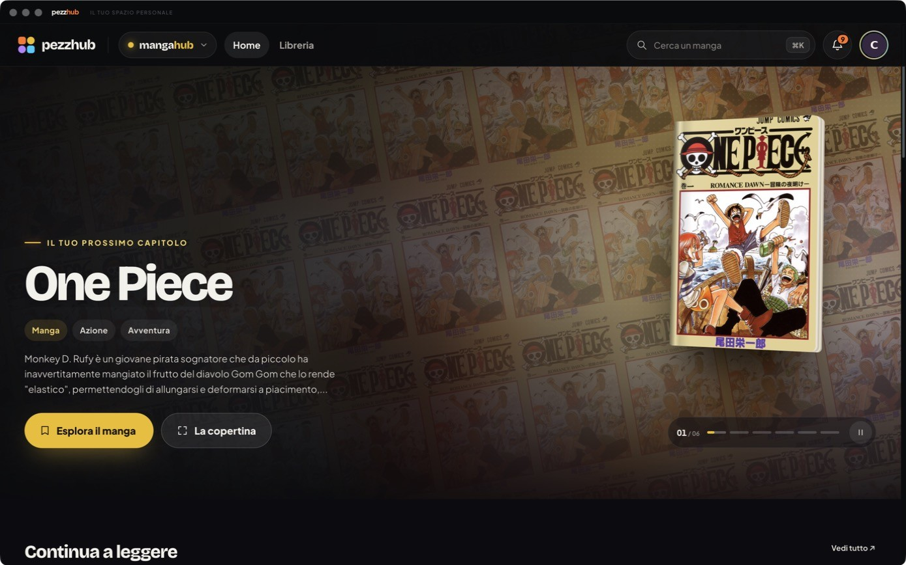
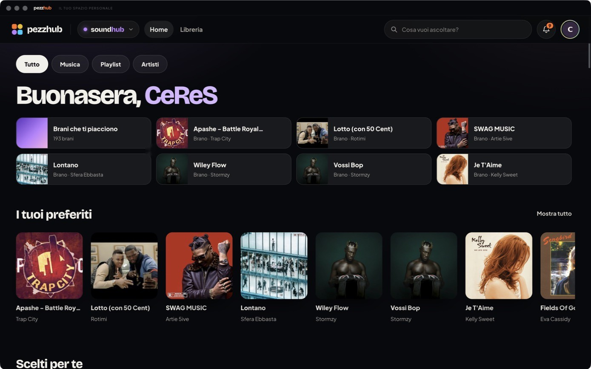
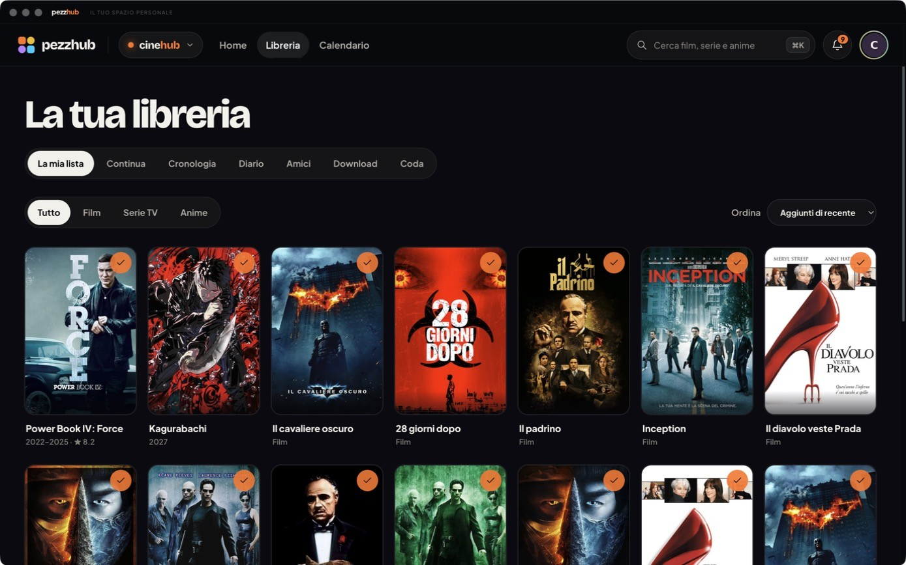

# pezzhub

**Movies, TV shows, anime, manga, music and live TV in one free app, with your progress in sync on every device.**

[Website](https://pezzhub.netlify.app/) · [Download](https://github.com/ceres077/pezzhub-releases/releases/latest) · [Community on Reddit](https://www.reddit.com/r/pezzhub) · [Report a problem](https://github.com/ceres077/pezzhub-releases/issues)

## What it does

pezzhub puts four "worlds" in one place, and everyone at home gets their own profile with their own library,
progress and taste. With an optional pezzhub account everything stays in sync between your devices in real time:
pause an episode on your PC and resume it on your TV at the same second.

- 🎬 **Movies, TV shows & anime** – trailers, TMDB ratings, "Continue watching", release calendar, watch diary and
  "Watch together" to watch a title in sync with a friend. Built-in MPV player with fullscreen and picture-in-picture.
- 📚 **Manga** – manga, manhwa and manhua with a built-in reader that remembers your chapter and page.
- 🎵 **Music** – songs, albums, artists and playlists, synced lyrics, reorderable queue, song radio and Spotify
  favorites import.
- 📺 **Live TV** – channels and a full TV guide with your own Xtream (IPTV) subscription.
- 🔄 **Real-time sync** – profiles, library, progress, playlists and connected accounts follow you everywhere.
- 👥 **Profiles** – one for every person at home, up to six.

Works with **Stremio add-ons** and **Nuvio plugin repositories**. Free, no ads.
Available in English, Italian, French, Spanish and German.

## The four worlds

| | |
|---|---|
|  | **cinehub** · Movies, TV shows and anime. A featured showcase with trailers, detail pages with plot and ratings, "Continue watching", library, release calendar, diary and "Watch together". |
|  | **Detail pages** · Plot, TMDB ratings and trailer. Resume from the saved minute, add to your list or to tonight's plan, mark as watched. |
|  | **mangahub** · Manga, manhwa and manhua: catalog, personal library, reader, and resume from the chapter and page you reached. |
|  | **soundhub** · Songs, albums, artists and playlists. Favorites, a reorderable queue, synced lyrics, radio from the song you're playing, and Spotify favorites import. |
|  | **tvhub and library** · tvhub brings live channels and a TV guide with your own Xtream subscription. The library gathers your list, history, diary and downloads, per profile. |

## Supported devices

| Device | Requirements | File to download |
|---|---|---|
| Windows | 64-bit Windows 10 or 11 | `pezzhub-setup-X.Y.Z.exe` |
| Mac with Apple Silicon (M1, M2, M3, M4…) | macOS 11 or later | `pezzhub-mac-arm64-X.Y.Z.dmg` |
| Mac with an Intel processor | macOS 11 or later | `pezzhub-mac-x64-X.Y.Z.dmg` |
| Android phone and tablet | Android 8 or later, 64-bit | `pezzhub-android-X.Y.Z.apk` |
| Android TV (alpha) | Android TV 8 or later | `pezzhub-tv-X.Y.Z.apk` |

Every file is in the [latest release](https://github.com/ceres077/pezzhub-releases/releases/latest).
Each version ships for all devices at once, with the same number.

On **Android TV** everything works with the remote: rows of titles, a side bar, voice search from the remote's
microphone and a first-run guide. The TV app is still in **alpha**, so expect some rough edges.

**Coming soon:** Samsung TV (Tizen) and LG TV (webOS).

## One account, everything in sync

An account is optional: without one, pezzhub works locally. With an account, every change reaches your other
devices right away: profiles, library, watch history and progress, preferences, music (favorites, playlists,
recent plays and queue), manga and tvhub. Linked accounts (Stremio, Trakt and extensions with a key) are set up
once and work everywhere. When two devices change the same thing, the latest change wins.
A deleted profile disappears from every device.

## Installing

- **Windows:** run the setup and follow the installer.
- **Mac:** open the dmg and drag pezzhub to Applications. pezzhub has no paid Apple certificate, so macOS asks
  for confirmation on first launch: open *System Settings › Privacy & Security* and click *Open Anyway*.
  You only need to do this once.
- **Android:** open the APK on your phone and, if Android asks, allow installs from that source.
- **Android TV:** copy the APK to the TV (for example with a USB stick) and open it with a file manager.

Updates then arrive from the app, in *Settings › Updates*: pezzhub downloads the new version, checks its SHA-256
fingerprint and offers to install it. Profiles and settings are kept. The Mac `.zip` files and the `android-…`
entries on the releases page are used by automatic updates: you don't need to download them.

## Community and feedback

Join **[r/pezzhub](https://www.reddit.com/r/pezzhub)** for feedback, bug reports, feature ideas and help.
Join even if you only lurk.

pezzhub is a one-person project and help is very welcome: beta testers (especially for Android TV and the
upcoming Samsung and LG apps), translators, designers and developers. Open an
[issue](https://github.com/ceres077/pezzhub-releases/issues) or write on r/pezzhub.

## Content, security and privacy

pezzhub does not provide or host any content: it only uses the sources, extensions and subscriptions you set up
yourself, which you must have the right to access. This repository only holds installers, release notes and this
page: no personal data, credentials or media files. The source code lives in a separate repository. Only download
pezzhub from this repository's releases.

## Reporting a problem

Open an [issue](https://github.com/ceres077/pezzhub-releases/issues) with your pezzhub version, your device and
the steps to reproduce the problem. Don't attach passwords, tokens or links that contain credentials.
